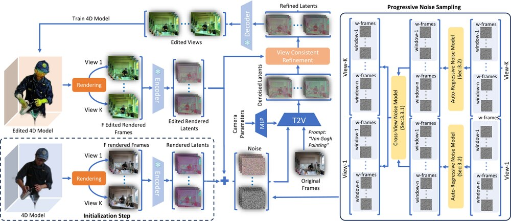

<!-- Copy this file to _posts/YYYY-MM-DD-short-title.md, edit, and push. -->

Write a short intro paragraph here. It is also used as the summary if you leave `description` empty.

## Background

Inline math uses single dollars, like $p_\theta(x)$ or $\mathbb{E}_{x \sim p}[f(x)]$.

Display math uses double dollars on their own lines:

$$
\mathcal{L}_{\text{FM}}(\theta) = \mathbb{E}_{t \sim \mathcal{U}[0,1],\, x_0 \sim p_0,\, x_1 \sim p_1}
\left\| v_\theta(x_t, t) - (x_1 - x_0) \right\|^2
$$

Numbered, aligned equations work too:

$$
\begin{align}
x_t &= (1 - t)\, x_0 + t\, x_1 \label{eq:interp} \\
\frac{d x_t}{dt} &= x_1 - x_0
\end{align}
$$

You can refer back to Eq. $\eqref{eq:interp}$.

## Images

Put images in `assets/img/blog/<post-name>/` and reference them like this.
A line of italic text right below an image becomes its caption.


*Fig. 1. An example figure with a caption.*

## Code

```python
import torch

def flow_matching_loss(model, x0, x1):
    t = torch.rand(x0.shape[0], 1, device=x0.device)
    xt = (1 - t) * x0 + t * x1
    target = x1 - x0
    return ((model(xt, t) - target) ** 2).mean()
```

## Other formatting

> Block quotes are good for key takeaways.

| Method | Steps | Success rate |
|--------|-------|--------------|
| Diffusion policy | 100 | 0.82 |
| Flow matching | 10 | 0.85 |

## References

[1] Lipman et al. "Flow Matching for Generative Modeling." ICLR 2023.
